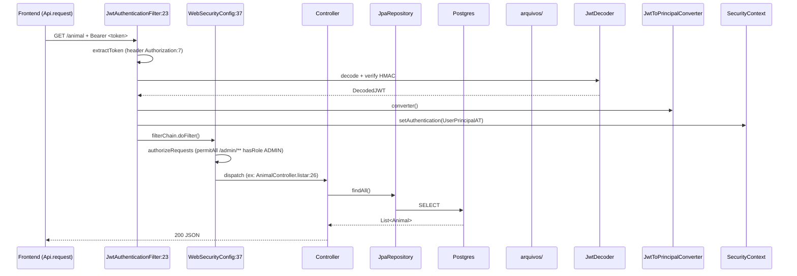

# 01 – Arquitetura

## 1. Visão Geral

```
Browser (React 18) 
  → fetch Api.request() (frontend/src/api/index.js:21)
  → Spring Boot 2.7.15 :8080 (br.com.ufra.simulator_afast.Application.java:6)
    → JwtAuthenticationFilter (security/JwtAuthenticationFilter.java:23)
    → Controllers (controllers/*)
    → Services/Repositories (JPA)
    → PostgreSQL 9.6 (postgres/docker-compose.yml:5)
    → FS classpath src/main/resources/arquivos/ (ImagemJanelaController.java:35)
```

- **Estilo:** Monolito REST stateless, sem gateway, sem filas.
- **Pacotes:** `br.com.ufra.simulator_afast` com subpacotes `controllers` (5), `models` (7), `pojos` (5), `repositories` (4), `security` (8), `services` (3) – ver `src/main/java/br/com/ufra/simulator_afast/` (`bash ls -R src`).
- **Build:** Maven Wrapper 3.8.4 (`wrapper/maven-wrapper.properties:2`), `pom.xml:5` parent `spring-boot-starter-parent:2.7.15`, Java 11 (`pom.xml:17`).

## 2. Dependências chave (pom.xml)

| Grupo | Artefato | Versão | Uso |
|-------|----------|--------|-----|
| `org.springframework.boot` | `starter-web` | 2.7.15 | REST, Jackson |
| `starter-data-jpa` | – | 2.7.15 | Hibernate + repositories |
| `starter-security` | – | 2.7.15 | Filter chain, BCrypt, AuthenticationManager |
| `postgresql` | `postgresql` | runtime | Driver JDBC |
| `org.projectlombok` | `lombok` | – | `@Data, @Builder` |
| `com.auth0` | `java-jwt` | 4.2.2 | `JwtIssuer.java:17`, `JwtDecoder.java:15` |
| `javax.xml.bind` | `jaxb-api` | 2.3.0 | Compat Java 11 |
| `jackson-databind` | – | 2.12.7.1 | `RelatorioPOJO.java:8` manual parse |

Sem `springdoc-openapi`, `flyway`, `validation`, `actuator`, `testcontainers`.

## 3. Estrutura de pastas

```
simulador-afast-backend/
├── pom.xml
├── Dockerfile                      # quebrado (ver 07-operations.md)
├── docker-compose.yml              # 8080:8080 + host.docker.internal
├── docker-compose.override.yml     # dev: monta .:/app + SPRING_PROFILES_ACTIVE=dev
├── docker-compose.prod.yml         # prod: 80:8080 replicas 2
├── postgres/docker-compose.yml     # postgres:9.6 5432:5432 jr/123654789/simulador
├── wrapper/maven-wrapper.properties
├── src/main/java/br/com/ufra/simulator_afast/
│   ├── Application.java            # @SpringBootApplication
│   ├── controllers/ (5)
│   ├── models/ (7)
│   ├── pojos/ (5 DTOs)
│   ├── repositories/ (4)
│   ├── security/ (8)
│   └── services/ (3, 1 vazio)
├── src/main/resources/
│   ├── application.yaml            # datasource + jwt secret
│   └── arquivos/ (8 PNGs + inserts.sql)
└── src/test/java/ (2 ApplicationTests contextLoads)
```

Total ~1259 LOC Java (`bash wc -l src/main/java/...`).

## 4. Fluxo de requisição (sequência)



- `JwtIssuer.issue()` em `AuthController.login:46` gera token `exp +1 day`, claims `e=email`, `a=roles`.
- `CustomUserDetailsService.loadUserByUsername:19` busca `UsuarioService.findByEmail` → `UsuarioRepository.findByEmail:12` (`List<Usuario>`).
- Sem refresh token real: frontend chama `POST /api/token/refresh/` (`frontend/src/api/index.js:12`) que **não existe** no backend (404).

## 5. Componentes por camada

### 5.1 Controllers

- `AnimalController.java:20` `@RequestMapping("/animal")` – CRUD Animal
- `ImagemJanelaController.java:37` – lógica central do domínio (sortear, upload, pontuação)
- `AuthController.java:24` `@PostMapping("/auth/login")` – única rota auth
- `UsuarioController.java:22` – cadastro e admin
- `FeedbackController.java:19` – criação/listagem feedbacks

Todos `@CrossOrigin` aberto (`WebSecurityConfig.corsConfigurationSource:62` também `*`).

### 5.2 POJOs / DTOs

- `AnimalPOJO.java:14` agrega `List<ImagemPOJO>` (usado em `/sortear-animais` e `/animal/{id}/imagens`)
- `ImagemPOJO.java:10` expõe `caminho`, `temLiquido`, `janela`, `animal` id, `MultipartFile file` (usado em deserialização)
- `UsuarioPOJO.java:14` expõe só `id,email,nome,role,created` (sem password)
- `FeedbackPOJO.java:11` mapeia `Feedback` → `usuario:nome`
- `RelatorioPOJO.java:12` **dead code** – nunca retornado em controller, só usado como exemplo de parse JSON em `Feedback.data`

### 5.3 Repositories

```java
AnimalRepository extends JpaRepository<Animal,Long> { List<Animal> findAllByIsActiveTrue(); } // AnimalRepository.java:10
FeedbackRepository { findAllByOrderByCreatedAt(); findByUsuarioIdOrderByCreatedAt(Long) } // FeedbackRepository.java:10
ImagemJanelaRepository { findByAnimalIdOrderByJanela(Long) } // ImagemJanelaRepository.java:11
UsuarioRepository { List<Usuario> findByEmail(String) } // deveria ser Optional
```

Sem `@Query` nativa, sem paginação (`Pageable` ausente).

### 5.4 Segurança

Ver `04-security.md` para detalhes. Cadeia: `JwtAuthenticationFilter` → `UsernamePasswordAuthenticationFilter` (`WebSecurityConfig.java:38` `addFilterBefore`).

## 6. Dependências externas

- **PostgreSQL** – única infra real. Config via `application.yaml:4` (`ddl-auto:update` cria schema automaticamente).
- **Filesystem** – `src/main/resources/arquivos/` serve como “object storage” (anti-pattern ver `06-file-storage.md`).
- **Frontend** – `TCC-SimuladorFast/frontend` consome via `REACT_APP_API_URL` ( `docker-compose.yml:14` monta volume `./frontend` – acoplamento monorepo legado).

## 7. Não-funcionais observados

| Aspecto | Estado atual | Risco |
|---------|--------------|-------|
| Escalabilidade | Stateless ok, mas FS local impede horizontal scale | Alto |
| Observabilidade | Sem actuator, sem logs estruturados, só `System.out.println(e)` (`ImagemJanelaController.java:121`) | Médio |
| Migrations | `update` em prod pode dropar coluna silenciosamente | Alto |
| Testes | 2 `contextLoads` (`src/test/java/**/ApplicationTests.java:10`) | Alto |
| Validação | Sem `spring-boot-starter-validation`, campos `@Column` nullable mas sem Bean Validation | Médio |
| Documentação API | Sem OpenAPI | Médio |

## 8. Próximos passos arquiteturais (sem implementar agora)

1. Extrair `StorageService` interface (abstrai `Files.write`/`Files.delete`).
2. Introduzir Flyway + `ddl-auto:validate`.
3. Adicionar `springdoc-openapi` para gerar `openapi.yaml`.
4. Trocar `List<Usuario> findByEmail` → `Optional<Usuario>`.

---
*Fontes: `pom.xml:1`, `Application.java:1`, `security/*`, `postgres/docker-compose.yml:1`, `frontend/src/api/index.js:1`*
