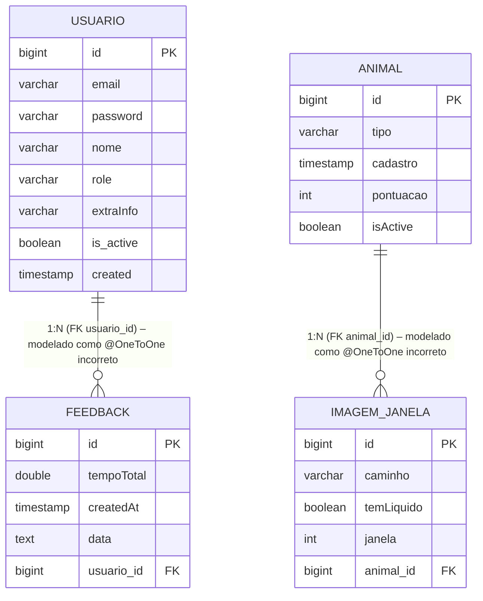

# 02 – Modelo de Dados

## 1. ER – Mermaid



> **Nota:** Diagrama reflete **realidade do banco** (FKs funcionam), mas anotações JPA estão erradas (ver §3).

## 2. Entidades – detalhe por arquivo

### 2.1 Usuario (`models/Usuario.java:9`)

```java
@Entity @Data
public class Usuario {
  @Id @GeneratedValue(AUTO) Long id;
  Boolean is_active = true;               // linha 13, default true em Java, não no DDL
  String email;                           // sem @Column nullable, sem unique
  @Column(nullable=true) String nome;     // 20
  String password;                        // BCrypt, sem length
  @Column(nullable=true) String role;     // 28 – valores "ROLE_ADMIN/TECNICO/USER"
  @Column(nullable=true) String extraInfo;// 31
  @Column Date created = new Date();      // 34 – new Date() por instância
}
```

- **Tabela gerada:** `usuario (id, is_active, email, nome, password, role, extra_info, created)` – nomes snake_case auto.
- **Seeds:** `inserts.sql:4` 3 usuários (admin@admin.com, medico@medico.com, user@user.com) com senha `$2a$10$N6b1...` (123 ou 123456). **Insert com sintaxe inválida** (ver §5).
- **Repositório:** `UsuarioRepository.java:12` `List<Usuario> findByEmail(String)` – permite duplicatas; `UsuarioController.create:29` verifica `size()>0` e retorna 409, mas sem constraint unique no banco (race condition).
- **Dívida:** `role` string livre; deveria ser `enum` + `@Enumerated`; `email` sem `unique=true` e sem `nullable=false`.

### 2.2 Animal (`models/Animal.java:11`)

```java
@Entity @Data @AllArgsConstructor @NoArgsConstructor
public class Animal {
  @Id @GeneratedValue(AUTO) Long id;
  @Column String tipo;           // 20 – "cachorro"/"gato" (livre)
  @Column Date cadastro;         // 23
  @Column int pontuacao;         // 26 – derivado count(temLiquido)
  @Column(name="isActive") Boolean isActive; // 29 – camelCase no banco
}
```

- **Regra:** `ImagemJanelaController.atualizarPontuacao:193` recalcula `pontuacao = count(temLiquido)` após cada upload/update/delete.
- **Seeds:** `inserts.sql:10` 2 animais id 1 (cachorro true) e 2 (gato false).
- **Queries:** `AnimalRepository.java:10` `findAllByIsActiveTrue()` usada em `ImagemJanelaController.listar:49` (sortear).
- **Dívida:** `pontuacao` armazenada mas derivável; `cadastro` poderia ser `@CreationTimestamp`; `isActive` default `false` setado em `AnimalController.novoAnimal:39`, mas entidades criadas via SQL podem ficar inconsistentes.

### 2.3 ImagemJanela (`models/ImagemJanela.java:7`)

```java
@Entity @Data
public class ImagemJanela {
  @Id @GeneratedValue(AUTO) Long id;
  @Column(nullable=true) String caminho; // 14 – "animal_{id}_{hd,hr,er,cc}.png"
  @Column Boolean temLiquido = true;     // 17
  @Column(nullable=true) int janela;     // 20 – 0:hd 1:hr 2:er 3:cc (AREAS)
  @OneToOne @JoinColumn(nullable=false) Animal animal; // 24 – BUG: deveria ser ManyToOne
}
```

- **Mapeamento físico:** `imagem_janela (id, caminho, tem_liquido, janela, animal_id)` com `animal_id` FK NOT NULL.
- **Seeds:** 8 linhas para `animal 12` e `24` (que não existem em `animal` seeds 1,2 – FK quebrada se constraints reais).
- **Repositório:** `ImagemJanelaRepository.java:11` `findByAnimalIdOrderByJanela(Long)` – ordena 0..3.
- **Caminho:** `ImagemJanelaController.cadastrar:102` `caminho = "animal_" + id + "_" + AREAS.get(janela) + ".png"`; `obterCaminhoPastaArquivos:43` usa `ClassPathResource("arquivos/").getPath()` (ver `06-file-storage.md`).

### 2.4 Feedback (`models/Feedback.java:9`)

```java
@Entity @Data
public class Feedback {
  @Id @GeneratedValue(AUTO) Long id;
  @Column(nullable=false) Double tempoTotal; // 16
  @Column Date createdAt = new Date();       // 19
  @Column(nullable=false, columnDefinition="TEXT") String data; // 22 JSON stringify
  @OneToOne @JoinColumn Usuario usuario;     // 27 – BUG: deveria ser ManyToOne, nullable true
}
```

- **Exemplo `data`:** array JSON com por animal: `{idAnimal, tempo, escore, escoreCorreto, janelas:[{janela:{title,className,janela}, resposta, respostaCorreta}]}` (`inserts.sql:18`).
- **POJOs:** `FeedbackPOJO.java:14` expõe `usuario:nome` (`FeedbackPOJO.fromFeedbackToPojo`); `RelatorioPOJO.java:12` **não usado** para persistir, só exemplo de `ObjectMapper.readValue(strData, new TypeReference<List<RelatorioPOJO>>() {})`.
- **Queries:** `FeedbackRepository.java:10` `findAllByOrderByCreatedAt()` e `findByUsuarioIdOrderByCreatedAt(Long)`.
- **Dívida:** sem FK index em `usuario_id` se crescer; `data` TEXT impede queries SQL por escore/tempo; `tempoTotal` Double mas inserts usam int.

## 3. Bugs de mapeamento JPA

| Entidade | Anotação atual | Correto | Impacto |
|----------|----------------|---------|---------|
| `ImagemJanela.animal` (`ImagemJanela.java:24`) | `@OneToOne` | `@ManyToOne(fetch=LAZY) @JoinColumn(nullable=false)` | Um animal tem 4 imagens, mas JPA entende 1:1 – `findByAnimalId` funciona por query method, mas `animal.getId()` pode gerar proxy extra e sem cascade |
| `Feedback.usuario` (`Feedback.java:27`) | `@OneToOne` | `@ManyToOne` | Um usuário tem N feedbacks; `@OneToOne` cria unique constraint implícito em alguns dialetos (Postgres não, mas Hibernate valida) |
| Ambos sem `fetch=LAZY` | EAGER default para OneToOne | LAZY para ManyToOne | N+1 em `FeedbackController.listarFeedbacks:42` → `FeedbackPOJO` acessa `f.getUsuario().getNome()` (lazy ainda causa N+1, precisa `JOIN FETCH` ou `@EntityGraph`) |

## 4. DDL efetivo (gerado por Hibernate `update`)

Sem `schema.sql`/`Flyway`. Para reproduzir:

```sql
create table usuario (
  id int8 not null, is_active boolean, created timestamp, email varchar(255),
  extra_info varchar(255), nome varchar(255), password varchar(255), role varchar(255), primary key (id)
);
create sequence hibernate_sequence start 1 increment 1;

create table animal (
  id int8 not null, cadastro timestamp, isActive boolean, pontuacao int4, tipo varchar(255), primary key (id)
);
create table imagem_janela (
  id int8 not null, caminho varchar(255), janela int4, tem_liquido boolean, animal_id int8 not null, primary key (id)
);
alter table imagem_janela add constraint FK... foreign key (animal_id) references animal;
create table feedback (
  id int8 not null, created_at timestamp, data text not null, tempo_total float8 not null, usuario_id int8, primary key (id)
);
alter table feedback add constraint FK... foreign key (usuario_id) references usuario;
```

> Confirmar com `mvn hibernate:ddl` ou `spring.jpa.show-sql=true` + logs.

## 5. Seeds – `src/main/resources/arquivos/inserts.sql`

**Arquivo atual está sintaticamente inválido para Postgres:**

```sql
-- atual (sem quotes em timestamp, valores incompatíveis)
insert into usuario values (1, 'administrador', 'ROLE_ADMIN', ...) -- ordem colunas errada (nome,role,email)
insert into animal values (1, 2024-01-22 07:09:20.735, 3, 'cachorro', true) -- timestamp sem ''
insert into feedback values (1, 1, '[{...}]', '2024-03-25 ...', 13) -- ordem (id, usuario_id, data, createdAt?, tempoTotal?) confusa
```

**Correção proposta (para doc + futura migration):**

```sql
insert into usuario (id, nome, role, email, password, extra_info, is_active, created)
values (1, 'administrador', 'ROLE_ADMIN', 'admin@admin.com', '$2a$10$N6b1mgH...', null, true, '2024-03-25 20:10:33.559');

insert into animal (id, cadastro, pontuacao, tipo, isActive)
values (1, '2024-01-22 07:09:20.735', 3, 'cachorro', true);

insert into imagem_janela (id, caminho, janela, tem_liquido, animal_id)
values (1, 'animal_12_hd.png', 0, true, 12);
-- etc. garantir animal 12 e 24 existam antes
```


## 6. Índices e performance

- Sem índices explícitos além de PK/FK. Recomendado:
  ```sql
  create index idx_usuario_email on usuario(email);
  create index idx_imagem_animal_janela on imagem_janela(animal_id, janela);
  create index idx_feedback_usuario_created on feedback(usuario_id, created_at desc);
  create index idx_animal_active on animal(isActive) where isActive = true;
  ```
- `AnimalController.listar:25` `findAll()` sem paginação – risco com muitos animais/imagens.

## 7. Próximos passos para alteração futura

1. **Criar enum `Role`** (`ROLE_ADMIN`, `ROLE_TECNICO`, `ROLE_USER`) + `@Enumerated(STRING)` – evita `WebSecurityConfig:45` `hasRole("ADMIN")` desencontrado com `ROLE_ADMIN` string.
2. **Trocar `@OneToOne` → `@ManyToOne`** + gerar migration Flyway `V2__fix_relations.sql`.
3. **Normalizar `Feedback.data`** – ou manter TEXT JSONB (Postgres `jsonb`) para queries, ou criar tabelas `tentativa`, `resposta_janela` (mais relacional).
4. **Adicionar constraints:** `unique(email)`, `not null` em `email,password,role`, `check(janela between 0 and 3)`.
5. **Versionar seeds** separados de schema.

---
*Fontes: `models/*.java`, `repositories/*.java`, `pojos/*.java`, `src/main/resources/arquivos/inserts.sql`, `application.yaml:11`*
