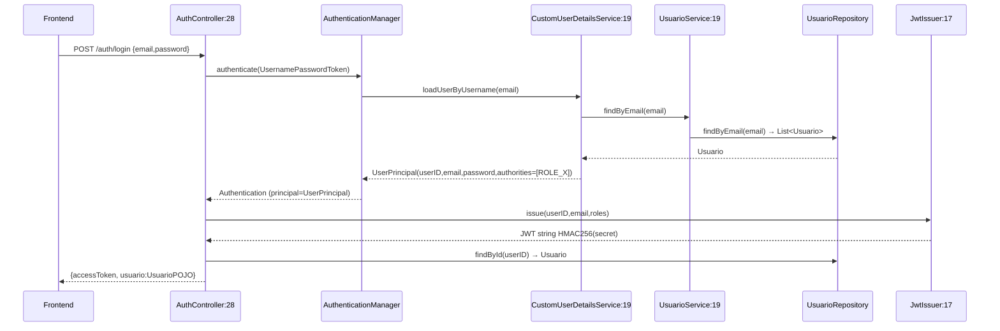

# 04 – Segurança

## 1. Visão geral

- **Tipo:** Stateless JWT (auth0 `java-jwt:4.2.2` `pom.xml:65`), sem sessão (`SessionCreationPolicy.STATELESS` `WebSecurityConfig.java:40`), sem refresh token, sem OAuth.
- **Secret:** `security.jwt.secret-key: verysecretkey...` (`application.yaml:31`, `security/JwtProperties.java:14` `@ConfigurationProperties("security.jwt")`).
- **Expiração:** `Instant.now().plus(1, ChronoUnit.DAYS)` (`JwtIssuer.java:19`).
- **Claims:** `sub=userId`, `e=email`, `a=roles` (`JwtIssuer.java:17`).
- **Password:** BCrypt (`WebSecurityConfig.passwordEncoder:51` `BCryptPasswordEncoder`).

## 2. Fluxo login



**Código relevante:**

```java
// AuthController.java:30
var authentication = authenticationManager.authenticate(
  new UsernamePasswordAuthenticationToken(request.getEmail(), request.getPassword()));
SecurityContextHolder.getContext().setAuthentication(authentication);
var principal = (UserPrincipal) authentication.getPrincipal();
var token = jwtIssuer.issue(principal.getUserID(), principal.getEmail(), roles);
```

```java
// JwtIssuer.java:17
return JWT.create()
  .withSubject(String.valueOf(userId))
  .withExpiresAt(Instant.now().plus(Duration.of(1, ChronoUnit.DAYS)))
  .withClaim("e", email).withClaim("a", roles)
  .sign(Algorithm.HMAC256(properties.getSecretKey()));
```

```java
// JwtDecoder.java:15
return JWT.require(Algorithm.HMAC256(properties.getSecretKey())).build().verify(token);
```

```java
// JwtToPrincipalConverter.java:10
UserPrincipal.builder().userID(Long.valueOf(jwt.getSubject()))
  .email(jwt.getClaim("e").asString())
  .authorities(claim.asList(SimpleGrantedAuthority.class)).build();
```

## 3. Filtro JWT

`JwtAuthenticationFilter.java:23` `OncePerRequestFilter`:

```java
extractTokenFromRequest(request) // header Authorization Bearer 7 chars
  .map(jwtDecoder::decode)
  .map(jwtToPrincipalConverter::converter)
  .map(UserPrincipalAuthenticationToken::new)
  .ifPresent(auth -> SecurityContextHolder.getContext().setAuthentication(auth));
filterChain.doFilter(request, response);
```

- **Não bloqueia** se token inválido – apenas não seta autenticação; `WebSecurityConfig` decide 401 depois.
- Sem tratamento de `JWTVerificationException` – exception sobe e pode vazar stacktrace (não há `AuthenticationEntryPoint` custom).

## 4. WebSecurityConfig (`security/WebSecurityConfig.java:37`)

```java
http.addFilterBefore(jwtAuthenticationFilter, UsernamePasswordAuthenticationFilter.class);
http.cors().and().csrf().disable()
  .sessionManagement().sessionCreationPolicy(STATELESS).and()
  .formLogin().disable()
  .antMatcher("/**")
  .authorizeRequests(registry -> registry
    .antMatchers("/auth/login").permitAll()
    .antMatchers(POST,"/usuarios").permitAll()
    .antMatchers(OPTIONS,"/**").permitAll()
    .antMatchers("/ws/images/**").permitAll()
    .antMatchers("/admin/**").hasRole("ADMIN")
    .anyRequest().authenticated());
```

| Rota | Regra | Observação |
|------|-------|------------|
| `POST /auth/login` | permitAll | – |
| `POST /usuarios` | permitAll | único cadastro aberto; sem captcha |
| `OPTIONS /**` | permitAll | preflight CORS |
| `GET /ws/images/**` | permitAll | **imagens públicas sem auth** – intencional p/ quiz? |
| `/admin/**` | `hasRole("ADMIN")` | espera `ROLE_ADMIN` (`Usuario.role`); `WebSecurityConfig:45` usa `hasRole` que adiciona prefixo `ROLE_` automaticamente |
| `anyRequest()` | authenticated | resto exige JWT |

**CORS:**

```java
// WebSecurityConfig.java:62
CorsConfiguration config = new CorsConfiguration();
config.setAllowedOriginPatterns(List.of("*"));
config.addAllowedMethod("*");
config.addAllowedHeader("*");
config.setAllowCredentials(true);
```

- `*` com `allowCredentials:true` é **inválido** per spec (browser bloqueia). Deveria ser `allowedOriginPatterns = frontend URL` ou `allowCredentials=false`. Frontend em `http://localhost:3000` funciona por `*` mas falha em produção com credenciais.
- Sem `maxAge`, sem `exposedHeaders`.

**PasswordEncoder:**

```java
@Bean PasswordEncoder passwordEncoder() { return new BCryptPasswordEncoder(); } // WebSecurityConfig:51
```
Usado em `UsuarioController.create:35` `passwordEncoder.encode(usuario.getPassword())`.

## 5. UserPrincipal & UserDetails

`UserPrincipal.java:13` implementa `UserDetails`:

- `userID:Long`, `email`, `password` (`@JsonIgnore`), `authorities` (coleção `SimpleGrantedAuthority`).
- `getUsername()` retorna `nome` (!) (`UserPrincipal.java:35` `return nome`) – mas `CustomUserDetailsService` seta `authorities` com `user.getRole()` e `email` como `loadUserByUsername` param. **Inconsistência:** `getUsername()` deveria ser `email` (usado como principal em logs). Não quebra porque `JwtIssuer` usa `email` claim `e`.

`CustomUserDetailsService.java:19`:

```java
var user = userService.findByEmail(username).orElseThrow(); // throws NoSuchElementException → 500 se email não existe, não 401
return UserPrincipal.builder()
  .userID(user.getId()).email(user.getEmail()).password(user.getPassword())
  .authorities(List.of(new SimpleGrantedAuthority(user.getRole()))).build();
```

`UsuarioService.java:19`:

```java
public Optional<Usuario> findByEmail(String email) {
  List<Usuario> usuarios = repository.findByEmail(email);
  if(usuarios.size()>0) return Optional.of(usuarios.get(0));
  return Optional.empty();
}
```

- `UsuarioRepository.findByEmail` retorna `List` – permite duplicatas (ver `02-data-model.md`).

## 6. Roles

| Role | Seed | Pode acessar |
|------|------|--------------|
| `ROLE_ADMIN` | `admin@admin.com` (`inserts.sql:4`) | tudo + `/admin/**` |
| `ROLE_TECNICO` | `medico@medico.com` | tudo exceto `/admin/**` (mas `hasRole ADMIN` bloqueia) |
| `ROLE_USER` | `user@user.com` | tudo exceto `/admin/**` |

**Promoção:** `UsuarioController.promover:48` toggle `ROLE_USER ↔ ROLE_TECNICO`, nunca `ADMIN`. Promover admin só via SQL.

## 7. Vulnerabilidades e hardening (OWASP)

| ID | Problema | Arquivo:linha | Severidade | Mitigação |
|----|----------|---------------|------------|-----------|
| S01 | Secret hardcoded, curto, em repo | `application.yaml:31` | **Alta** | Mover para `env JWT_SECRET`, min 256 bits, rotacionar |
| S02 | CORS `*` + `allowCredentials:true` | `WebSecurityConfig.java:64` | Alta | `allowedOrigins = ${FRONTEND_URL}` |
| S03 | `/ws/images/**` permitAll + path traversal | `ImagemJanelaController.java:182` `new File(path+nomeImagem)` | Alta | Validar `nomeImagem` regex `^animal_\d+_(hd\|hr\|er\|cc)\.png$`, usar `Path.normalize()` + check `startsWith(pastaArquivos)` |
| S04 | Sem rate limiting em `/auth/login` | `AuthController.java:28` | Média | Add `Bucket4j` ou `spring-boot-starter-data-redis` rate limiter |
| S05 | `UserDetailsService` lança `NoSuchElementException` → 500 | `CustomUserDetailsService.java:19` `orElseThrow()` sem arg | Média | `orElseThrow(() -> new UsernameNotFoundException(...))` → 401 |
| S06 | Senha sem política (aceita `""`) | `UsuarioController.java:27` sem `@Valid` | Média | Add `@NotBlank @Size(min=6)`, `@Email` |
| S07 | JWT sem `iat`, sem `iss`, sem `jti` | `JwtIssuer.java:17` | Baixa | Add `withIssuedAt`, `withIssuer("simulador-afast")` |
| S08 | Sem `AuthenticationEntryPoint` custom | `WebSecurityConfig.java:37` | Baixa | Retornar JSON `{"msg":"Unauthorized","status":401}` em vez de HTML |
| S09 | `PasswordEncoder` sem força configurada | `WebSecurityConfig.java:51` default 10 | Baixa | OK, mas documentar custo |
| S10 | `/usuarios` POST permitAll sem captcha | `WebSecurityConfig.java:42` | Baixa | OK para TCC, mas em prod add throttling |

## 8. Frontend – armazenamento token

- `frontend/src/api/index.js:26` `sessionStorage.getItem('access')` para request.
- `frontend/src/api/index.js:5` `localStorage.getItem('refresh')` para refresh (inconsistente).
- Login (`frontend/src/pages/login.js` – não lido mas `AuthController` retorna `accessToken`): frontend deve fazer `sessionStorage.setItem('access', data.accessToken)`.
- Refresh inexistente: `Api.refreshToken:3` chama `POST ${baseUrl}/api/token/refresh/` com `{refresh}` → 404, depois `Api.request:47` recursão `await Api.request(...)` pode loop infinito em 401.

**Recomendação:** Implementar refresh real ou remover código morto e usar só `accessToken` 1 dia.

---
---
*Fontes: `security/*.java`, `application.yaml:29`, `controllers/AuthController.java`, `frontend/src/api/index.js:1`*
