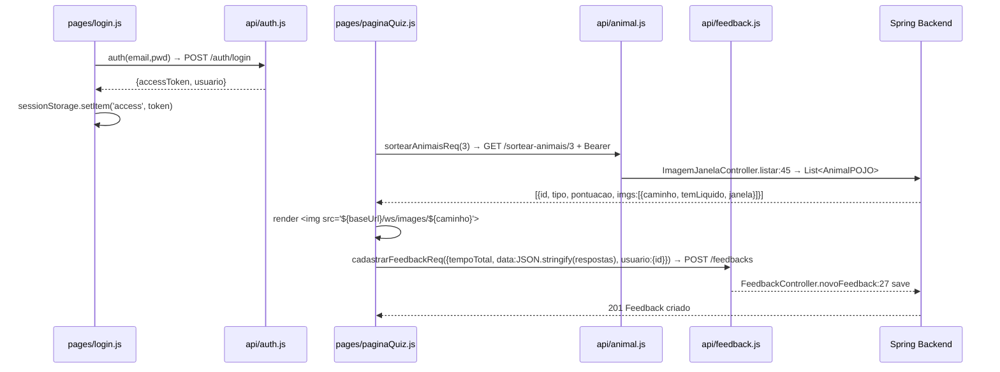

# 10 – Integração com Frontend

> Frontend repo: `TCC-SimuladorFast/frontend` (`src/api/*`, `src/pages/*`, `src/components/*`).  
> Backend base URL: `REACT_APP_API_URL=http://localhost:8080` (`frontend/.env:1`, `TCC-SimuladorFast/.env:1`).

## 1. Api base (`frontend/src/api/index.js:1`)

```js
const baseUrl = process.env.REACT_APP_API_URL; // index.js:1
const Api = {
  refreshToken: async () => { /* POST ${baseUrl}/api/token/refresh/ com {refresh} de localStorage */ }, // 3-18
  request: (method, endpoint, { params, body, contentType="application/json", hasToken=true, stringfyBody=true }) => {
    url = `${baseUrl}/${endpoint}`; // 24
    token = sessionStorage.getItem('access'); // 26
    headers['Authorization'] = `Bearer ${token}`; // 37
    if(response.status===401){ await Api.refreshToken(); return Api.request(...) } // 47
    else reject({msg, status}); // 53
  }
}
```

**Divergências críticas:**

| # | Problema | Frontend:linha | Backend | Impacto |
|---|----------|----------------|---------|---------|
| I01 | `refreshToken` chama `POST /api/token/refresh/` com `localStorage.refresh` | `index.js:12` | **Não existe** (backend só `POST /auth/login`) | 401 no `request:47` tenta refresh, falha 404, loop recursivo pode estourar call stack |
| I02 | `sessionStorage.access` vs `localStorage.refresh` | `index.js:5` vs `26` | Backend retorna `accessToken` em `AuthController:51`, nunca `refresh` | `refresh` sempre `null` |
| I03 | `baseUrl + "/" + endpoint` | `index.js:24` | Backend sem prefix `/api` (ex: `/animal`, `/auth/login`) | Se `REACT_APP_API_URL=http://localhost:8080/api` (com `/api`), todas rotas 404 (frontend não usa `/api` exceto refresh) |
| I04 | `params` como `URLSearchParams` mas backend não lê query params exceto `FeedbackController:40` `MultiValueMap` (ignorado) | `index.js:28` | `FeedbackController` ignora `queryParams` | Sem paginação via query |

**Fix proposto:**

```js
// frontend/src/api/index.js – remover refresh ou implementar real
request: async (method, endpoint, opts) => {
  const token = sessionStorage.getItem('access'); // ou localStorage para persistir
  // ...
  if(response.status===401){
    sessionStorage.removeItem('access');
    window.location.href = '/login'; // em vez de refresh inexistente
  }
}
```

## 2. Mapeamento endpoint a endpoint

| Frontend função | Arquivo:linha | Método + Path | Backend controller:linha | Payload | Retorno usado no frontend |
|-----------------|---------------|---------------|--------------------------|---------|---------------------------|
| `auth(email,pwd)` | `auth.js:3` | `POST auth/login` | `AuthController.java:28` | `{email,password}` | `{accessToken, usuario}` → `sessionStorage.setItem('access', accessToken)` (em `pages/login.js`) |
| `getUsuario()` | `auth.js:7` | `GET usuario` | **Não existe** | – | **404** – frontend chama `GET usuario` sem rota backend (deveria ser `GET /admin/usuarios/me` ou `GET /usuarios/{id}`) |
| `cadastrarUsuarioReq(body)` | `usuarios.js:11` | `POST usuarios` | `UsuarioController.java:27` | `Usuario` | `201 UsuarioPOJO` |
| `listarUsuariosReq()` | `usuarios.js:3` | `GET admin/usuarios` | `UsuarioController.java:43` | – | `List<UsuarioPOJO>` → `pages/adminUsuarios.js` |
| `promoverUsuarioReq(id)` | `usuarios.js:7` | `POST admin/promover-usuario/${id}` | `UsuarioController.java:48` | – | `UsuarioPOJO` atualizado |
| `sortearAnimaisReq(qtd)` | `animal.js:3` | `GET sortear-animais/${qtd}` | `ImagemJanelaController.java:45` | – | `List<AnimalPOJO>` → `pages/paginaQuiz.js` |
| `listarAnimaisReq()` | `animal.js:8` | `GET animal/` | `AnimalController.java:25` | – | `List<Animal>` → `pages/adminAnimais.js` |
| `cadastrarAnimalReq(body)` | `animal.js:11` | `POST animal/` | `AnimalController.java:35` | `{tipo}` | `Animal` |
| `atualizarAnimalReq(id,body)` | `animal.js:14` | `PUT animal/${id}` | `AnimalController.java:42` | `{tipo,isActive}` | `Animal` |
| `deletarAnimalReq(id)` | `animal.js:17` | `DELETE animal/${id}` | `AnimalController.java:57` | – | `ReturnResponse` |
| `listarImagensAnimalReq(id)` | `animal.js:21` | `GET animal/${id}/imagens` | `ImagemJanelaController.java:70` | – | `AnimalPOJO` com `imgs` |
| `cadastrarImagemAnimalReq(id,FormData)` | `animal.js:24` | `POST animal/${id}/imagens` multipart | `ImagemJanelaController.java:84` | `janela,temLiquido,file` | `ReturnResponse` |
| `atualizarImagemAnimalReq(id,imgId,FormData)` | `animal.js:27` | `PUT animal/${id}/imagens/${imgId}` | `ImagemJanelaController.java:122` | `janela,temLiquido,file?` | `ReturnResponse` |
| `deletarImagemAnimalReq(id,imgId)` | `animal.js:31` | `DELETE animal/${id}/imagens/${imgId}` | `ImagemJanelaController.java:162` | – | `ReturnResponse` |
| `` | `pages/paginaQuiz.js` (?) | `GET ws/images/${caminho}` | `ImagemJanelaController.java:182` | – | `byte[] JPEG` (na verdade PNG) |
| `listarFeedbacksReq(id?)` | `feedback.js:3` | `GET feedbacks/${id}` | `FeedbackController.java:39,47` | – | `''` → `GET /feedbacks` (todos), `id` → `GET /feedbacks/{idUsuario}` (por usuário) |
| `cadastrarFeedbackReq(body)` | `feedback.js:8` | `POST feedbacks/` | `FeedbackController.java:27` | `{tempoTotal,data,usuario:{id}}` | `201` |

**Não mapeados (backend sem caller):** `GET /animal/{id}` (single), `PUT /feedbacks` inexistente.

**Chamadas órfãs (frontend sem backend):** `GET usuario`, `POST /api/token/refresh/`.

## 3. Exemplo fluxo quiz (frontend → backend)



## 4. Contratos JSON – exemplos reais

**Sortear animais response (AnimalPOJO):**

```json
[
  {
    "id": 12,
    "tipo": "cachorro",
    "pontuacao": 3,
    "cadastro": "2024-01-22T07:09:20.735+00:00",
    "isActive": true,
    "imgs": [
      { "id":1, "caminho":"animal_12_hd.png", "temLiquido":true, "janela":0, "animal":12 },
      { "id":2, "caminho":"animal_12_hr.png", "temLiquido":true, "janela":1, "animal":12 },
      { "id":3, "caminho":"animal_12_er.png", "temLiquido":false, "janela":2, "animal":12 },
      { "id":4, "caminho":"animal_12_cc.png", "temLiquido":true, "janela":3, "animal":12 }
    ]
  }
]
```

**Feedback POST:**

```json
{
  "tempoTotal": 68.0,
  "data": "[{\"idAnimal\":12,\"tempo\":13,\"escore\":3,\"escoreCorreto\":3,\"janelas\":[{\"janela\":{\"title\":\"HD\",\"className\":\"hd\",\"janela\":0},\"resposta\":\"Tem líquido\",\"respostaCorreta\":\"Tem líquido\"}]}]",
  "usuario": { "id": 1 }
}
```
`FeedbackPOJO` GET retorna `data` como string + `tempoTotal`, `createdAt`, `usuario:"administrador"`.

## 5. Variáveis de ambiente

| Var | Onde | Valor dev | Valor prod sugerido |
|-----|------|-----------|---------------------|
| `REACT_APP_API_URL` | `frontend/.env:1`, `TCC-SimuladorFast/.env:1` | `http://localhost:8080` | `https://api.seudominio.com` |
| `PORT` (React) | `docker-compose.yml:14` volume | `3000` | `80` via Nginx |

**CORS:** Frontend `http://localhost:3000` → Backend `http://localhost:8080` precisa `Access-Control-Allow-Origin: http://localhost:3000` (hoje `*` funciona mas com `allowCredentials` quebra – ver `04-security.md` S02).

## 6. Páginas frontend que consomem backend

| Página | Arquivo | API calls | Observação |
|--------|---------|-----------|------------|
| `login.js` | `frontend/src/pages/login.js` | `auth()` | Seta `sessionStorage` |
| `cadastro.js` | `frontend/src/pages/cadastro.js` | `cadastrarUsuarioReq` | `POST /usuarios` |
| `paginaQuiz.js` | `frontend/src/pages/paginaQuiz.js` | `sortearAnimaisReq`, `cadastrarFeedbackReq`, `GET /ws/images` | Core do simulador |
| `adminAnimais.js` | `frontend/src/pages/adminAnimais.js` | `listarAnimaisReq`, `cadastrarAnimalReq`, `listarImagensAnimalReq`, `cadastrar/atualizar/deletarImagem` | CRUD completo |
| `adminUsuarios.js` | `frontend/src/pages/adminUsuarios.js` | `listarUsuariosReq`, `promoverUsuarioReq` | Só admin |
| `feedbacks.js` | `frontend/src/pages/feedbacks.js` | `listarFeedbacksReq` | Lista todos ou por usuário |
| `paginaInicial.js` | `frontend/src/pages/paginaInicial.js` | – | Estática |
| `App.js` | `frontend/src/App.js` | – | Router, `Topo.js`, `drawer.jsx` |

## 7. Checklist integração

- [ ] Remover `getUsuario()` (`auth.js:7`) ou criar `GET /usuarios/me` no backend (retorna `UsuarioPOJO` do `SecurityContext`).
- [ ] Remover `refreshToken` (`index.js:3`) ou implementar `POST /auth/refresh` com JWT refresh (ver `04-security.md`).
- [ ] Padronizar `sessionStorage` vs `localStorage` (escolher um).
- [ ] Garantir `REACT_APP_API_URL` sem trailing `/` e sem `/api` prefix (backend não usa `/api`).
- [ ] Adicionar `interceptor` para 401 → redirect `/login` em vez de loop.
- [ ] Validar `FormData` (`animal.js:24` `stringfyBody:false, contentType:""`) já correto para multipart.

---
*Fontes: `TCC-SimuladorFast/frontend/src/api/*.js`, `TCC-SimuladorFast/frontend/src/pages/*.js`, `controllers/*.java`*
